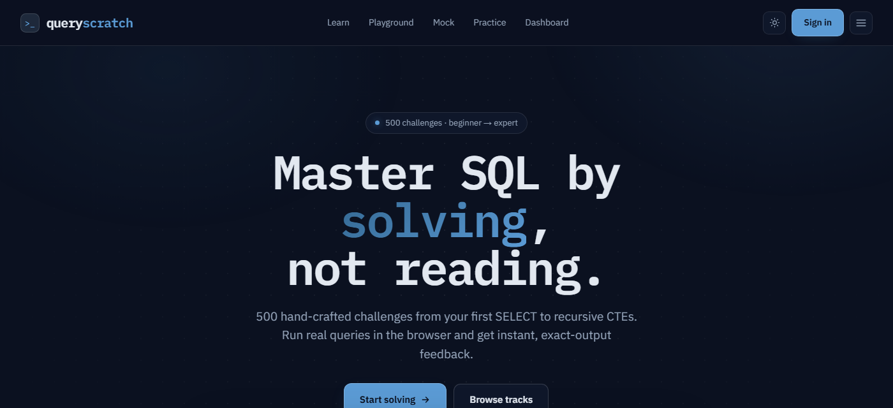

<div align="center">

# `sumit=#` Sumit Kumar Prajapat — Portfolio

**Data Analyst · BI Developer · PL-300 Certified**

A single-page portfolio built around a **terminal / SQL editor** aesthetic.
No framework, no build step — one hand-written `index.html`.

<a href="https://skpkush.github.io/Sumitkprajapat/"></a>

<a href="Sumit_Prajapat_Data_Analyst.pdf"></a>
<a href="https://www.linkedin.com/in/sumit-k-prajapat/"></a>
<a href="mailto:sumitkprajapat29@gmail.com"></a>
<a href="https://github.com/Skpkush"></a>

</div>

---

## ★ Latest build — Grocery Retail Analytics

<a href="https://github.com/Skpkush/grocery-retail-analytics"></a>

> **Does a grocer's promotional spend actually change behaviour?**
> 1.46M real transactions · 2,469 households · a full year of dunnhumby *The Complete Journey* data.

| 1.46M | 50.6% | 102 + 6 | 58 / 58 |
| :---: | :---: | :---: | :---: |
| transactions modelled in dbt | coupon redemptions going to shoppers already buying | dbt data tests + unit tests, run in CI | Power BI values reconciled to SQL |

dbt project on DuckDB (28 models, staging → intermediate → marts, incremental fact tables) → 13 SQL analyses → difference-in-differences with placebo tests → 5-page Power BI report (45 DAX measures) + Streamlit app. `dbt build` runs on every push.

[`→ repo`](https://github.com/Skpkush/grocery-retail-analytics) &nbsp;·&nbsp; [`🟢 live app`](https://grocery-retail-analytics-gej2xcqxwhwypm7lvjhher.streamlit.app/)

---

## What's on the site

| section | what it does |
| :--- | :--- |
| `psql hero` | an animated SQL query that "returns" the intro row |
| `projects.sql` | tab filters rewrite a live `SELECT … WHERE … ORDER BY` query, plus a psql result-set of headline metrics |
| `journey.git` | career history rendered as `git log` commits |
| `⌘K` palette | `Ctrl+K` / `⌘K` jumps between sections and runs actions (resume, email, live apps) |
| theme | light / dark toggle, scroll-reveal animations, ATS-friendly resume download |

### Featured projects

<table>
  <tr>
    <td width="50%" valign="top"><a href="https://github.com/Skpkush/grocery-retail-analytics"></a><br/><b><a href="https://github.com/Skpkush/grocery-retail-analytics">Grocery Retail Analytics</a></b><br/><sub>dbt · 1.46M transactions → <b>50.6% of coupons go to habitual buyers</b></sub></td>
    <td width="50%" valign="top"><a href="https://github.com/Skpkush/Healthcare-Insurance-Claims-Analytics"></a><br/><b><a href="https://github.com/Skpkush/Healthcare-Insurance-Claims-Analytics">Healthcare Provider Fraud Detection</a></b><br/><sub>558K claims → <b>226× fraud concentration</b> · 90.1% recall</sub></td>
  </tr>
  <tr>
    <td width="50%" valign="top"><a href="https://github.com/Skpkush/mf-analytics-platform"></a><br/><b><a href="https://github.com/Skpkush/mf-analytics-platform">Mutual Fund Analytics Platform</a></b><br/><sub><b>14,384 schemes</b> · 51 AMCs · Prophet NAV forecasts</sub></td>
    <td width="50%" valign="top"><a href="https://github.com/Skpkush/Olist-E-Commerce-Analytics-Dashboard"></a><br/><b><a href="https://github.com/Skpkush/Olist-E-Commerce-Analytics-Dashboard">Olist E-Commerce Analytics</a></b><br/><sub>112,650 rows → <b>~97% one-time buyers</b> · 40+ DAX</sub></td>
  </tr>
  <tr>
    <td width="50%" valign="top"><a href="https://github.com/Skpkush/Customer-Segmentation"></a><br/><b><a href="https://github.com/Skpkush/Customer-Segmentation">Customer Segmentation</a></b><br/><sub>RFM + K-Means · <b>Silhouette 0.52</b> · live app</sub></td>
    <td width="50%" valign="top"><a href="https://www.queryscratch.com/"></a><br/><b><a href="https://www.queryscratch.com/">QueryScratch</a></b><br/><sub><b>500 SQL challenges</b> · in-browser sandbox</sub></td>
  </tr>
</table>

---

## Stack


Fonts: Inter + JetBrains Mono (Google Fonts). Hosted free on GitHub Pages.

## Run locally

It's a static site — open `index.html` in a browser, or serve it:

```bash
python -m http.server 8000
# then visit http://localhost:8000
```

## Structure

```
index.html                        # the entire site (HTML + CSS + JS)
Sumit_Prajapat_Data_Analyst.pdf   # downloadable resume
assets/queryscratch.png           # project screenshot
```

<div align="center">

<sub><code>sumit=# COMMIT;</code> — open to Data Analyst · BI Developer · Power BI Developer roles</sub>

</div>
